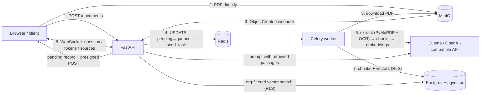

# Architecture



## Tenant isolation (three layers)

1. **Token.** The JWT's `org_id` is compared with the user row on every request; clients never supply an
   `org_id`. The database is the source of truth for role, organization and `is_active`, so deactivating a
   user takes effect immediately.
2. **Application.** Every query carries `WHERE org_id = :org_id`; MinIO object keys are prefixed with the
   organization id; a document from another organization returns `404`, never `403`.
3. **Database (RLS).** `documents` and `chunks` use `ENABLE` + `FORCE ROW LEVEL SECURITY` with the policy
   `org_id = NULLIF(current_setting('app.org_id', true), '')::uuid`. API and worker connect as `rag_app`
   (no superuser, no `BYPASSRLS`; migrations run as the table owner). Without `app.org_id` in the
   transaction no rows are visible (fail-closed), and `WITH CHECK` blocks writes into another organization.

`app.org_id` is set per transaction with `set_config(..., true)` (equivalent to `SET LOCAL`): automatically by
a SQLAlchemy `after_begin` hook in the API, and by `org_tx()` in the worker. It never leaks through the
connection pool.

## Document state machine

```
pending ──(MinIO event or /confirm)──▶ queued ──▶ processing ──▶ ready
                                                       └────────▶ failed
ready | failed ──(admin /reindex)──▶ queued
```

- Entry transitions use `UPDATE ... WHERE status IN (...) RETURNING`, so duplicate MinIO events or double
  clicks enqueue **one** job.
- If publishing the Celery task fails, the status is reverted and the webhook answers `500`, so MinIO
  redelivers (its notification queue is persisted on disk).
- The worker takes `SELECT ... FOR UPDATE` to claim the document, does the heavy work **outside** any
  transaction, then replaces the chunks (delete + insert + status update) in a single transaction.
  `acks_late` redelivers the job if the worker dies; `ready` documents ignore duplicate deliveries.
- An hourly reaper marks jobs stuck in `queued`/`processing` for 30+ minutes as `failed` and deletes
  `pending` documents (and orphaned objects) older than one day.

## Chat flow

1. The client opens `/ws/chat` and sends `auth` as its first message (10 s timeout).
2. For each `question`: token expiry and user status are revalidated, the per-user rate limit is applied, the
   question is embedded, and the vector search runs in a short tenant-scoped transaction that is **closed
   before** streaming starts (no database connection is held while the LLM generates).
3. The server sends `sources`, then `token` events as they arrive, then `done`. With no matching passages it
   answers directly without calling the LLM.
4. The prompt tells the model to answer only from the context, cite `[n]`, and treat the retrieved text as
   untrusted data (basic prompt-injection hygiene).

## Design decisions and trade-offs

| Topic | Choice | Alternative |
|---|---|---|
| Upload | Presigned POST policy (key, type, size enforced) | Presigned PUT (cannot limit size) |
| Event delivery | MinIO webhook with on-disk queue, `/confirm` as fallback | Kafka / NATS / SQS |
| Chunking | Per page (~2400 chars, 300 overlap) for exact page citations | Sliding window across pages |
| Search | HNSW cosine + `iterative_scan` (pgvector 0.8+) | Partition by organization; hybrid BM25 + vector |
| Rate limiting | Fixed window in Redis, fails open | Sliding window / token bucket |
| WebSocket auth | Token in first message + per-question revalidation | Session cookie |
| AI providers | OpenAI-compatible HTTP API (Ollama by default) | Provider-specific SDKs |

## Observability

- JSON logs with `request_id` (propagated via `X-Request-ID`), `user_id` and `org_id`.
- `GET /metrics`: request count and latency, chat outcomes, retrieval latency, time to first token, rate-limit hits.
- `GET /ready` checks Postgres and Redis; Flower on port 5555 for the task queue.
